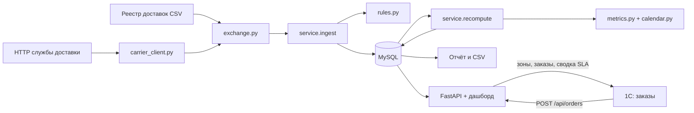
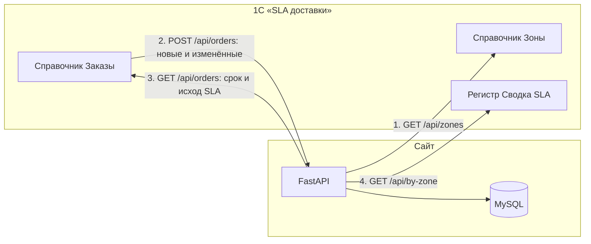

# Конвейер агрегации заказов и расчёта SLA доставки

Тема 5 учебной практики по МДК «Инструментальные средства разработки программного обеспечения».

Сервис принимает реестр доставок от службы доставки (CSV-файл или HTTP), проверяет каждую строку, сохраняет
заказы в MySQL, рассчитывает для каждого заказа срок доставки по тарифу и рабочему календарю, определяет,
выполнен ли SLA, и агрегирует показатели по дням и зонам. Результат — консольный отчёт, выгрузка CSV для
учётной системы, веб-дашборд с графиками и обмен с 1С:Предприятием (заказы вносятся в 1С и уходят на сайт,
сроки и исходы SLA возвращаются в 1С).

## Слои

| Слой | Что в проекте | Где в коде |
|---|---|---|
| Вход | реестр доставок CSV (файл или HTTP), генератор заказов со сбоями, `POST /api/orders`, заказы из 1С | `sla/exchange.py`, `sla/carrier_client.py`, `sla/simulate.py` |
| Проверка | формат времени, справочные поля, порядок времён, повторы номеров | `sla/rules.py` |
| Расчёт | срок по тарифу и рабочему календарю, исход SLA, P50/P90, агрегация по дням и зонам | `sla/calendar.py`, `sla/metrics.py` |
| Хранение | MySQL 8.4: 7 таблиц, отклонённые строки с причиной | `db/init.sql`, `sla/repository.py` |
| Отчёт | консоль, CSV для учётной системы, дашборд, `GET /api/orders` для 1С | `sla/cli.py`, `sla/api.py`, `sla/templates/dashboard.html` |
| 1С | конфигурация «SLA доставки»: заказы, зоны, сводка SLA, обмен по HTTP | `onec/src/` |
| Тесты | 95 тестов трёх уровней | `tests/` |



## Обмен с 1С

В 1С менеджер вносит заказы, сайт проверяет их и считает SLA, результат возвращается в 1С. Обмен — обычные
HTTP-запросы с JSON к API сайта, его запускает одна команда **«Синхронизировать с сайтом»**.



| Объект 1С | Что хранит | Откуда данные |
|---|---|---|
| Справочник «Зоны» | код, название, нормативы экспресс (ч) и стандарт (раб. дн.) | с сайта |
| Справочник «Заказы» | номер (код), канал, зона, тариф, статус, создан, доставлен, перенос; срок и исход SLA; флаг «Нужно отправить»; ответ сайта об ошибке | вносятся в 1С и загружаются с сайта |
| Перечисления «Каналы заказа», «Тарифы доставки», «Статусы заказа» | значения полей заказа | — |
| Регистр сведений «Сводка SLA» | по каждой зоне: заказов, вовремя, просрочено, SLA %, P50, P90 | с сайта |
| Константа «Адрес сайта SLA» | адрес API, по умолчанию `http://localhost:8000` (если в `.env` другой `API_PORT` — поменяйте и здесь) | заполняется при первом обмене |
| Общий модуль «ОбменССайтом» | весь код обмена | — |
| Общая команда «Синхронизировать с сайтом» | кнопка в разделе «Доставка и SLA» → «Сервис» | — |

Правила обмена:

- запись заказа пользователем ставит флаг «Нужно отправить» (`ПередЗаписью` в модуле объекта); при обмене
  такие заказы отправляются на сайт, флаг снимается, в заказ записываются срок и исход SLA;
- если сайт отклонил заказ, причина (например, «доставка раньше создания» или «время создания в будущем»)
  показывается сообщением и сохраняется в поле «Ответ сайта об ошибке», флаг остаётся;
- зоны и расчёт SLA ведёт сайт: правка зоны в 1С на сайт не уходит и перезаписывается при следующем обмене;
- коды значений на сайте и в 1С сопоставляются в функции `КодыСайта` (`site` ↔ «Сайт», `in_transit` ↔ «В пути»…).

Пока в `.env` задано `REPORT_NOW=2026-11-06T18:00`, сайт считает это время текущим и не примет заказ, созданный позже.

### Развернуть базу 1С из исходников

Нужна платформа 1С:Предприятие 8.3.27 (подходит учебная версия) и запущенный сайт (`docker compose up -d api`).

```bash
# macOS, учебная версия; на Windows: "C:\Program Files\1cv8t\8.3.27.1688\bin\1cv8t.exe"
V8=/opt/1cv8t/8.3.27.1688/1cv8t
$V8 CREATEINFOBASE File="$HOME/1C_DeliverySLA"
$V8 DESIGNER /F "$HOME/1C_DeliverySLA" /LoadConfigFromFiles "$PWD/onec/src" /UpdateDBCfg
$V8 ENTERPRISE /F "$HOME/1C_DeliverySLA" /C Синхронизировать   # обмен без окон, протокол - в журнал регистрации
```

После правок в конфигураторе исходники выгружаются обратно командой
`$V8 DESIGNER /F "$HOME/1C_DeliverySLA" /DumpConfigToFiles "$PWD/onec/src"`.

## Что нужно

- Docker Desktop (на Windows — с WSL 2), 2 ГБ памяти для Docker;
- VS Code (необязательно) — задачи лежат в `.vscode/tasks.json`;
- 1С:Предприятие 8.3.27 (необязательно, для обмена с 1С).

## Запуск с нуля

```bash
cp .env.example .env            # PowerShell: Copy-Item .env.example .env
docker compose up --build -d api
```

Команда поднимает MySQL, применяет схему, загружает справочник зон и образец реестра, пересчитывает SLA
(сервис `app` печатает отчёт в лог) и запускает веб-сервис. Дашборд: <http://localhost:8000>,
описание API: <http://localhost:8000/docs>.

Отчёт в консоль:

```bash
docker compose logs app
docker compose run --rm app python -m sla.cli report --from 2026-10-26 --to 2026-11-06
```

Остановка: `docker compose down` (данные сохраняются), `docker compose down -v` (база удаляется).

## Команды конвейера

| Команда | Что делает |
|---|---|
| `python -m sla.cli init` | применить `db/init.sql` (повторно — без дублей) |
| `python -m sla.cli zones exchange/zones.csv` | загрузить справочник зон |
| `python -m sla.cli import exchange/reestr_dostavok.csv` | загрузить реестр доставок из файла |
| `python -m sla.cli import --url reestr_dostavok.csv` | то же по HTTP (сервис `carrier`, профиль `carrier`) |
| `python -m sla.cli simulate --count 200 --seed 42` | сгенерировать поток заказов со сбоями |
| `python -m sla.cli recompute` | пересчитать SLA и сводку по дням и зонам |
| `python -m sla.cli report [--from --to --zone]` | отчёт в консоль |
| `python -m sla.cli export exchange/otchet_sla.csv` | выгрузить отчёт SLA в CSV |
| `python -m sla.cli rejected` | последние отклонённые строки |
| `python -m sla.cli pipeline` | всё сразу: схема, справочник, реестр, пересчёт, отчёт |

Внутри Docker команды запускаются так: `docker compose run --rm app python -m sla.cli <команда>`.

## Правила расчёта SLA

- **Экспресс**: срок = время создания + норматив зоны в часах (календарные часы).
- **Стандарт**: заказ, созданный в рабочий день до 14:00, принимается в работу в тот же день, иначе — в
  следующий рабочий день; срок — 21:00 N-го рабочего дня после дня приёма (N — норматив зоны). Выходные и
  праздники из таблицы `holiday` не считаются.
- **Перенос по просьбе клиента**: срок = согласованное время переноса.
- Доставка **ровно в срок** — вовремя; на минуту позже — просрочка.
- Заказ в пути после срока — «просрочен в пути» и учитывается в SLA; в пути до срока и отменённые — не учитываются.
- SLA, % = вовремя / (вовремя + просрочено + просрочено в пути). P50 и P90 — процентили времени доставки
  методом ближайшего ранга.

## Тесты

```bash
docker compose run --rm --build --no-deps app pytest -v     # без базы: 89 passed, 6 skipped
docker compose --profile test run --rm --build test           # с MySQL: 95 passed
docker compose run --rm --no-deps app flake8 sla tests kit t05_orders_sla
```

Без Docker (Python 3.12):

```bash
python -m venv .venv
source .venv/bin/activate         # PowerShell: .venv\Scripts\Activate.ps1
pip install -r requirements.txt
pytest -q
```

| Уровень | Файлы | Чем подменяются внешние части |
|---|---|---|
| Ядро | `test_rules.py`, `test_calendar.py`, `test_metrics.py`, `test_service.py`, `test_simulate_settings.py`, `test_t05_starter.py` | `InMemoryRepository`, фиксированное `NOW` |
| Адаптеры | `test_exchange.py`, `test_carrier_client.py`, `test_api.py` | `FakeSession`, `TestClient` |
| Настоящая база | `test_repository_mysql.py` | ничем, нужен `RUN_DB_TESTS=1` |

CI: `.github/workflows/ci.yml` — линтер, тесты на Linux и Windows, тесты с MySQL, сборка образа.

## Структура

```
sla/                пакет приложения
  domain.py         объекты: зона, заказ, результат SLA
  rules.py          правила проверки строки реестра
  calendar.py       рабочий календарь, отсечка, сроки
  metrics.py        исход SLA, процентили, агрегация
  service.py        сценарии: приём пакета, пересчёт
  repository.py     хранилище: в памяти и MySQL
  exchange.py       форматы файлов обмена
  carrier_client.py HTTP-клиент службы доставки
  simulate.py       генератор заказов со сбоями
  cli.py            командная строка
  api.py, server.py веб-сервис и его сборка
  templates/, static/  дашборд (Chart.js лежит локально)
onec/src/           конфигурация 1С в XML (выгрузка конфигуратора)
t05_orders_sla/, kit/  исходная заготовка темы (SQLite), её тесты сохранены
db/init.sql         схема и начальные данные MySQL
exchange/           образцы файлов обмена
tests/              автотесты
```

## Файлы обмена

Общее: CSV, разделитель `;`, кодировка UTF-8 (BOM допускается), первая строка — заголовки, порядок колонок
не важен.

**Справочник зон** `exchange/zones.csv` (ключ — `Код`, повторная загрузка обновляет запись):

| Колонка | Пример | Ограничения |
|---|---|---|
| Код | `CTR` | обязателен, уникален |
| Наименование | `Центральный район` | обязательно |
| Экспресс_ч | `3` | целое 1–72 |
| Стандарт_дн | `1` | целое 1–10 |

**Реестр доставок** `exchange/reestr_dostavok.csv` (ключ — `Номер`):

| Колонка | Значения |
|---|---|
| Номер | латиница, цифры, дефис, до 32 символов |
| Канал | сайт, маркетплейс, телефон |
| Зона | код из справочника |
| Тариф | экспресс, стандарт |
| Создан, Доставлен, Перенос | `ГГГГ-ММ-ДД ЧЧ:ММ`, `ДД.ММ.ГГГГ ЧЧ:ММ` или ISO 8601 со смещением |
| Статус | доставлен, в пути, отменён |

**Отчёт SLA** `exchange/otchet_sla.csv` (создаётся командой `export`, в Git не хранится):
`Дата;Зона;Заказов;Вовремя;Просрочено;Просрочено_в_пути;В_работе;Отменено;SLA_%;P50_ч;P90_ч`.

## База данных

| Таблица | Назначение |
|---|---|
| `zone` | зоны доставки и нормативы |
| `holiday` | праздничные дни |
| `import_batch` | пакеты загрузки: источник, принято, отклонено |
| `orders` | заказы (ключ обмена — `order_no`) |
| `sla_result` | срок и исход SLA по каждому заказу |
| `sla_daily` | сводка по дням и зонам |
| `rejected` | отклонённые строки с причиной |

Запрос к базе из контейнера (обёртка `db/sql.sh` берёт пользователя и пароль из окружения контейнера):

```bash
docker compose exec db sql -e "SELECT code, name FROM zone"
```

Из VS Code или другой программы: сервер `localhost`, порт `3306` (`DB_PORT_HOST`), пользователь и пароль из `.env`.

Резервная копия и восстановление:

```bash
docker compose exec db sh -c 'mysqldump -uroot -p"$MYSQL_ROOT_PASSWORD" --databases delivery_sla' > delivery_sla.sql
docker compose exec -T db sh -c 'mysql -uroot -p"$MYSQL_ROOT_PASSWORD"' < delivery_sla.sql
```

## Библиотеки

| Библиотека | Версия | Зачем | Где подключена |
|---|---|---|---|
| fastapi, uvicorn | 0.162.0, 0.54.0 | веб-API и сервер | `api.py`, `server.py` |
| jinja2 | 3.1.6 | шаблон дашборда | `api.py` |
| pydantic | 2.14.1 | проверка тела запроса | `api.py` |
| requests | 2.34.2 | HTTP-выгрузка службы доставки | `carrier_client.py` |
| pymysql, cryptography | 1.2.3, 50.0.2 | драйвер MySQL и вход по `caching_sha2_password` | `repository.py` |
| pytest, hypothesis, httpx | 9.1.1, 6.170.12, 0.28.1 | тесты, тесты свойств, TestClient | `tests/` |
| flake8 | 7.4.1 | линтер | CI |
| Chart.js | 4.4.6 | графики дашборда | `static/chart.umd.min.js` |
